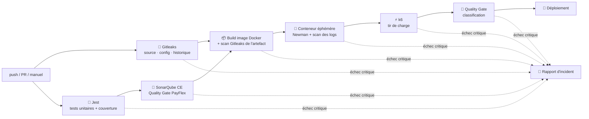

# PayFlex API — Pipeline CI/CD intelligent & Quality Gate

[](https://github.com/DaliGuerfali/TP2-DevOps-PayFlex/actions/workflows/main.yml)

TP2 DevOps Avancé — API REST de services financiers (Node.js / Express) et pipeline GitHub Actions
avec tests multi-niveaux, analyse SonarQube, détection de fuites de données (Gitleaks) et
Quality Gate qui classe chaque erreur en **critique** (arrêt immédiat, pas de déploiement) ou
**non-critique** (alerte, le pipeline continue).

**Équipe :** Mohamed Ali Guerfali · Adem Saidi · Ala Eddine Zaouali · Rami Gharbi

📄 **Rapport de synthèse : [docs/Rapport-de-synthese-TP2-DevOps.pdf](docs/Rapport-de-synthese-TP2-DevOps.pdf)**

## Architecture du pipeline



Chaque étape produit un fichier `metrics/*.json` (`scripts/quality-gate/evaluate.js`) avec un niveau
`OK` / `WARNING` / `CRITICAL`. Un résultat `CRITICAL` fait échouer le job : GitHub Actions annule
alors tous les jobs suivants (fail fast) et le job **Rapport d'incident** résume la cause exacte.

## Règles du Quality Gate

| Indicateur | Non-critique (warning, le pipeline continue) | Critique (pipeline fail) |
|---|---|---|
| Couverture de code (lignes) | 70 % ≤ couverture < 80 % | < 70 % |
| Bugs / Smells (SonarQube) | code smells, bugs mineurs | bug ou vulnérabilité BLOCKER/CRITICAL, Quality Gate SonarQube ERROR |
| Performance (k6) | p95 entre 200 et 500 ms, ou erreurs entre 1 et 2 % | p95 > 500 ms ou erreurs > 2 % (k6 `abortOnFail`) |
| Confidentialité (Gitleaks) | — | toute fuite : taux < 100 % |
| Tests d'intégration (Newman) | — | au moins une assertion en échec |

Les seuils sont dans [`quality-gate.config.json`](quality-gate.config.json).

**Taux de confidentialité** = (1 − fuites / max(seuil toléré, 1)) × 100 %. Avec le seuil imposé de 0,
la formule du TP divise par zéro ; on prend donc 1 comme dénominateur : 0 fuite → 100 %, une fuite ou plus → 0 %.
Le scan couvre le **code source**, les **fichiers de configuration**, **tout l'historique Git**, l'**artefact
Docker** (système de fichiers `/app` et configuration de l'image) et les **logs** de l'application. En plus des
règles Gitleaks par défaut (AWS, Stripe, clés privées, jetons…), `.gitleaks.toml` ajoute des règles PII :
numéros de carte bancaire (PAN) et IBAN.

## Scénarios de démonstration

Le workflow se lance à la main (**Actions → PayFlex CI/CD → Run workflow**) avec un scénario :

| Scénario | Effet | Résultat attendu |
|---|---|---|
| `nominal` | aucun | ✅ tout est vert, déploiement |
| `perf-warning` | latence simulée de 250 ms | ⚠️ alerte non-critique, déploiement maintenu |
| `perf-critical` | latence simulée de 700 ms | 🛑 k6 s'arrête (p95 > 500 ms), pas de déploiement |
| `data-leak` | `scripts/demo/inject-leak.sh` ajoute au build une clé Stripe, une clé AWS, une clé privée et un PAN, tous générés aléatoirement | 🛑 taux de confidentialité 0 %, pas de déploiement |

Aucun secret n'est versionné : les valeurs de la démo `data-leak` sont générées pendant le job.

## API

| Méthode | Route | Description |
|---|---|---|
| GET | `/health` | état du service |
| POST | `/api/accounts` | ouvrir un compte `{ owner, currency?, initialBalance? }` |
| GET | `/api/accounts/:id` | lire un compte |
| POST | `/api/accounts/:id/deposits` | dépôt `{ amount }` |
| POST | `/api/accounts/:id/withdrawals` | retrait `{ amount }` |
| GET | `/api/accounts/:id/transactions` | historique |
| POST | `/api/transfers` | virement `{ fromAccountId, toAccountId, amount }` (frais : 0 % < 100, 0,5 % jusqu'à 10 000, 0,25 % au-delà, min 1, max 50) |
| POST | `/api/payments/cards/validate` | validation Luhn d'une carte ; seul le numéro masqué est renvoyé |

Les logs sont en JSON et passent par `src/utils/redact.js`, qui masque les numéros de carte et les champs sensibles.

## Lancer en local

```bash
npm install
npm test -- --coverage          # tests unitaires + couverture
npm start                       # API sur http://localhost:3000
npm run test:integration        # Newman (npx newman si non installé)
k6 run tests/performance/load-test.js
docker build -t payflex-api . && docker run -p 3000:3000 payflex-api
```

## Arborescence

```
src/                    API (routes, services métier, middleware, redaction des logs)
tests/unit/             Jest (API, services, Quality Gate)
tests/integration/      collection Postman exécutée par Newman
tests/performance/      script k6
scripts/quality-gate/   evaluate.js (un indicateur) · report.js (rapport global / incident) · classify.js (règles)
scripts/sonar/          préparation du SonarQube éphémère et récupération des résultats
scripts/demo/           injection de fuite pour la démo
.github/workflows/      main.yml
docs/                   rapport de synthèse (PDF)
```
